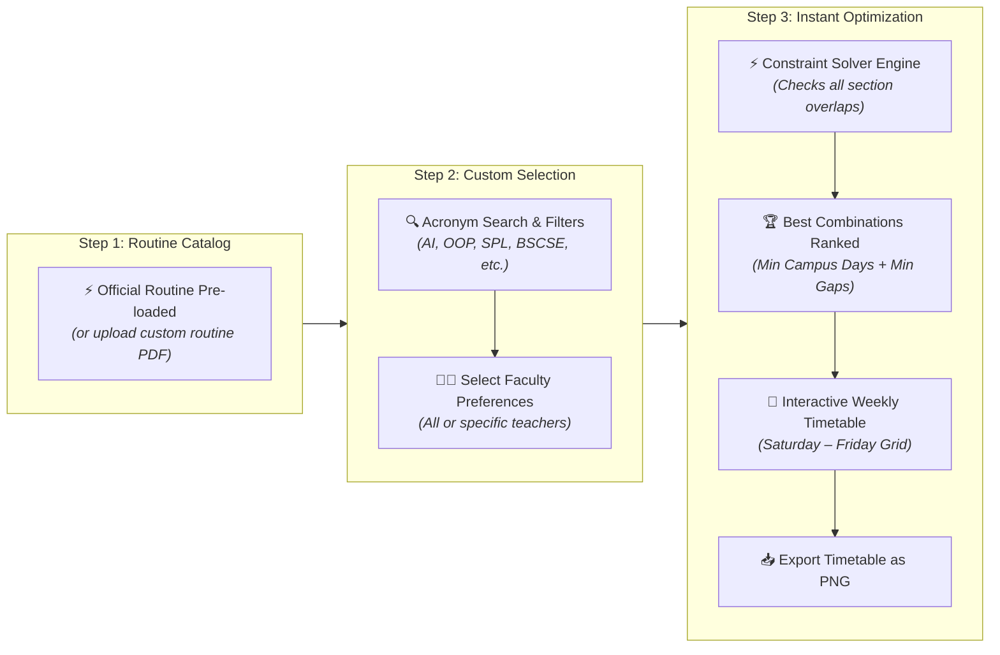

# 🗓️ UIU Routine & Schedule Optimizer

<div align="center">


**An intelligent, conflict-free routine builder for United International University (UIU) students.**  
Eliminate class clashes, minimize campus trips, and say goodbye to tedious manual scheduling.

[Quick Start](#-quick-start) • [How It Works](#-how-it-works) • [Visual Workflow](#-visual-workflow) • [Key Features](#-key-features) • [API Guide](#-api-endpoints)

</div>

---

## ⚡ The Problem & The Solution

Every trimester at UIU, students receive a massive course-offering PDF with **hundreds of sections, overlapping time slots, and multiple faculties**. Manually finding combinations that don't clash while avoiding 5-day campus commutes and 4-hour gaps between classes can take hours of trial and error.

**UIU Routine Optimizer automates this entire process in seconds:**
1. ⚡ **Pre-loaded Official Routine**: Automatically loads the official UIU routine on page entrance—no upload required!
2. 📄 **Custom PDF Support**: Upload your own department or trimester routine PDF anytime with animated progress tracking.
3. 🎯 Lets you pick courses and preferred faculties with **1-click chips** and advanced acronym search (`AI`, `OOP`, `SPL`, `DLD`).
4. ⚡ Calculates **every valid, zero-conflict weekly combination**.
5. 🏆 **Ranks combinations** by fewest campus days, then least waiting time.
6. 📅 Displays an **interactive weekly timetable** ready to export as a PNG image.

---

## 🚀 Quick Start

### 1. Clone & Run (One-Command Startup)

```bash
# Clone the repository
git clone https://github.com/itsnotTalha/UIU-Routine-Optimizer.git
cd UIU-Routine-Optimizer

# On Linux / macOS:
./run.sh

# On Windows:
run.bat
```

The script automatically sets up the Python virtual environment (`venv`), installs all dependencies, and launches the server at:
👉 **[http://127.0.0.1:8000](http://127.0.0.1:8000)**

### 2. Manual Setup (Alternative)

```bash
python3 -m venv venv
source venv/bin/activate       # On Windows: venv\Scripts\activate
pip install -r requirements.txt
uvicorn backend.main:app --host 127.0.0.1 --port 8000 --reload
```

---

## 📊 Visual Workflow

The entire application follows an intuitive **3-step guided flow**:



---

## 🖥️ Screen Layout & User Interface

The interface is divided into a **Control Station (Left)** and an **Interactive Timetable (Right)**:

```
+----------------------------------------------------------------------------------------------------+
|  [⚡ UIU Routine Optimizer]      [1. Upload PDF] -> [2. Pick Courses] -> [3. Schedules]   [☀️/🌙] [Demo] |
+------------------------------------------------------+---------------------------------------------+
|  LEFT PANEL: Input & Preferences                     |  RIGHT PANEL: Timetable & Results           |
|                                                      |                                             |
|  [ 📄 Routine PDF Mode ]  [ ✍️ Manual Mode ]          |  +---------------------------------------+  |
|                                                      |  | Status: Found 3,632 Clash-Free Routines|  |
|  STEP 1: Routine PDF                                 |  | 🗓️ 3 Campus Days  |  ⏳ 40m Gap Time   |  |
|  +------------------------------------------------+  |  +---------------------------------------+  |
|  |  ☁️ Drag & drop UIU PDF here or browse         |  |                                             |
|  |  [ 📄 Fall2026.pdf • 107 Courses • 791 Secs ]  |  |  Option Selector:                           |
|  +------------------------------------------------+  |  [ Option 1 ★ ] [ Option 2 ] [ Option 3 ]   |
|                                                      |                                             |
|  STEP 2: Choose Courses                              |  Weekly Timetable (Saturday - Friday):      |
|  [ Search: CSE 1111...               ]               |  Time: 08:30  10:00  11:30  13:00  14:30... |
|  Filters: [ All ] [ BSCSE ] [ BSDS ] [ BBA ]         |  Sat  [ CSE 1111 ]      [ ACT 2111 ]        |
|  +------------------------------------------------+  |  Sun         [ CSE 1112 Lab ]                |
|  | [✓] CSE 1111 - Structured Programming (24 sec) |  |  Mon  ....................................  |
|  | [✓] CSE 1112 - Programming Lab (23 sec)        |  |  Tue  [ CSE 1111 ]      [ ACT 2111 ]        |
|  | [✓] ACT 2111 - Financial Accounting (11 sec)   |  |  Wed  ....................................  |
|  +------------------------------------------------+  |  Thu  (Free Day - No Campus Trips!)         |
|                                                      |                                             |
|  STEP 3: Action                                      |  Actions:                                   |
|  [ ⚡ Find Clash-Free Routines                    ]  |  [ 📥 Download Timetable (PNG) ]            |
+------------------------------------------------------+---------------------------------------------+
```

---

## 📖 Step-by-Step User Guide

### 1️⃣ Step 1: Upload Routine PDF or Try Demo
- **Drag & Drop** your UIU course offering PDF (`Class Routine with faculty assign Fall 2026.pdf`) into the dropzone.
- **Don't have a PDF right now?** Click **"⚡ Try Demo"** in the top bar or on the empty state card. It loads real UIU routine data and pre-selects courses in one click!

### 2️⃣ Step 2: Choose Courses & Preferred Faculty
- **Filter by Program**: Click program pills (`BSCSE`, `BSDS`, `BBA`, etc.) to show only your department's offerings.
- **Select Courses**: Click course cards to toggle them.
- **Set Faculty Preferences**:
  - Keep **"All Faculty"** active if any teacher is fine.
  - Or click specific faculty pills (e.g. `[ ✓ Dr. Mohammad Kaykobad ]`) to restrict sections to your favorite instructors.

### 3️⃣ Step 3: View, Compare & Export Schedules
- Click **"⚡ Find Clash-Free Routines"**.
- The engine calculates all valid combinations and ranks them:
  $$\text{Priority 1: Fewest Campus Days} \quad \longrightarrow \quad \text{Priority 2: Minimal Waiting Gaps}$$
- Browse combinations using the option pills (`Option 1 ★`, `Option 2`, etc.).
- Click on any class block to view full details (Section name, Instructor, Room number, and Time slots).
- Click **"📥 PNG"** to save your conflict-free routine to your device.

---

## ✨ Features Overview

| Feature | Description |
| :--- | :--- |
| **📑 PDF Routine Importer** | Parses complex multi-page UIU tabular PDFs, handling multiple meeting slots, labs, and split rooms. |
| **⚡ Smart Backtracking Solver** | Recursively traverses section combinations with early pruning, evaluating thousands of options in milliseconds. |
| **🏆 Multi-Criteria Ranking** | Automatically sorts routines to maximize days off and minimize idle time between lectures. |
| **🎨 Modern Responsive UI** | Fluid viewport typography (`vw` / `vh`), sleek glassmorphism, and responsive layout for mobile, laptop, and desktop. |
| **☀️ Light & 🌙 Dark Themes** | Seamless one-click theme switcher that persists across visits and exports clean, theme-matched timetable images. |
| **✍️ Dual Input Modes** | Supports both official PDF imports and manual copy-paste section entry with auto-save. |
| **🔒 100% Private & Local** | All processing happens locally on your machine. Your routine selections are saved in your own browser's storage. |

---

## 🛠️ Project Structure

```
UIU-Routine-Optimizer/
├── backend/
│   ├── main.py              # FastAPI server entry point & static mounts
│   ├── models.py            # Pydantic schemas (Courses, Slots, Catalogs)
│   ├── catalog.py           # Catalog upload, storage, and optimization router
│   ├── pdf_import.py        # PDF table extraction & regex slot parsers
│   ├── optimizer.py         # Backtracking conflict-solver & ranking metrics
│   ├── parser.py            # Parser for manual section text
│   ├── catalogs/            # Cached parsed routine catalogs (.json)
│   └── tests/               # Pytest suite with test fixtures
├── frontend/
│   ├── index.html           # Main semantic HTML5 interface
│   ├── styles.css           # Glassmorphism, themes (dark/light), and fluid fonts
│   ├── app.js               # Calendar grid rendering, modal, & theme management
│   └── catalog.js           # PDF upload dropzone, course filters, & search
├── requirements.txt         # Python package dependencies
├── run.sh                   # Linux/macOS launcher script
└── run.bat                  # Windows launcher script
```

---

## 📡 API Endpoints

| Method | Endpoint | Description |
| :--- | :--- | :--- |
| `POST` | `/api/catalogs/import` | Upload a routine PDF (`multipart/form-data`) and receive a parsed catalog ID. |
| `GET` | `/api/catalogs/{id}` | Retrieve courses and sections for a previously parsed catalog. |
| `POST` | `/api/catalogs/optimize` | Solve and rank conflict-free schedules for selected courses and faculties. |
| `POST` | `/api/optimize` | Legacy manual section solver. |
| `GET` | `/api/courses` | Retrieve saved manual courses. |
| `POST` | `/api/courses` | Save manual courses to local storage. |

---

## 🧪 Running Tests

To run the automated test suite:

```bash
# Activate your virtual environment first
source venv/bin/activate

# Run backend tests
PYTHONPATH=. pytest backend/tests
```

All tests verify PDF parsing resilience, time boundary conversions, section collision detection, and multi-criteria schedule scoring.

---

## 🤝 Contributing & Feedback

Contributions, feature suggestions, and bug reports are welcome!
Feel free to open an issue or submit a pull request on [GitHub](https://github.com/itsnotTalha/UIU-Routine-Optimizer).

<div align="center">
  <sub>Built with ❤️ for UIU students.</sub>
</div>
