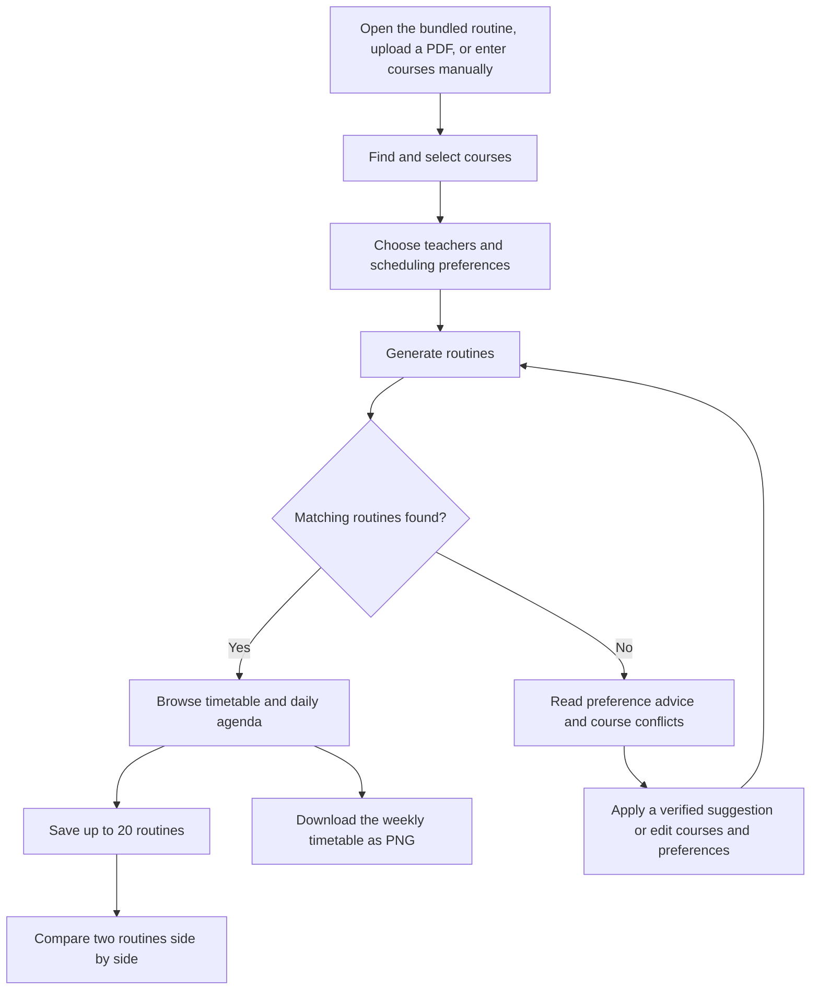

# About UIU Routine Optimizer

UIU Routine Optimizer helps United International University students turn course offerings into conflict-free weekly routines. Students choose courses, teachers, and scheduling preferences, then browse, compare, save, and export the resulting schedules.

This document describes the implemented workflow and features. Catalog contents depend on the routine PDF loaded into the application.

## User workflow



### 1. Load course offerings

- **Bundled routine:** The application attempts to load its default catalog on startup. Replacing the bundled PDF automatically refreshes the parsed catalog on the next default-catalog request, even with the same filename. Cached catalogs are checked against a SHA-256 hash of the PDF contents.
- **PDF import:** Upload a supported UIU course-offering PDF through the file picker or drag-and-drop area. Import progress, catalog information, and parsing warnings are displayed.
- **Return to the default routine:** Replace a custom catalog with the bundled routine.
- **Source PDF:** View the routine PDF exposed by the server when available.
- **Manual entry:** Add course names and paste section, teacher, and meeting information. Manual course definitions can be saved, restored, updated, and deleted through the backend.

Manual section format:

```text
A
Teacher Name
Monday 09:50-11:10
Wednesday 09:50-11:10
```

A section can contain multiple meetings, such as lectures on two days or a lab. The optimizer chooses a whole section, including all its meetings.

### 2. Find and select courses

- Search by course name, code, or acronym.
- Filter the catalog by program.
- Use **Selected only** to focus on chosen courses.
- Inspect available teachers and section details.
- Add or remove individual courses, or clear the selection.
- Allow any teacher or select specific teachers for each course.
- Reorder courses and teachers in Preferences using drag controls or arrow controls to express priority.
- For each selected faculty member, view their sections and meeting times on the course card or in Preferences. Click sections in preferred order; click again to remove a priority. Unranked sections remain available as fallbacks. Section priorities are saved with the catalog selection.

On mobile, search opens in a dialog sized to the visible viewport. Tapping its **Done** button clears the query and closes the dialog while retaining selected courses. A separate clear-search button lets the user clear the query and continue searching.

### 3. Set scheduling preferences

| Setting | Implemented behavior |
| --- | --- |
| **Days on campus** | Require exactly 2, 3, 4, or 5 days. **Any days** removes the exact-count restriction. |
| **Allowed class days** | Choose which weekdays may contain meetings. Every meeting of a selected section and every fixed slot must fit these days. Leave all unchecked to allow any day. |
| **Day-pair shortcuts** | Quickly select **Sat + Tue**, **Sun + Wed**, or **Any day**. |
| **Max classes per day** | Limit the number of meetings on each day, including labs and fixed slots. Blank means no limit. |
| **Earliest start** | Prevent regular class meetings from starting before the chosen time. Supports listed times and custom input. |
| **Latest finish** | Prevent regular class meetings from ending after the chosen time. Supports listed times and custom input. |
| **Minimum break** | Require a minimum gap between consecutive meetings, including fixed slots. **No minimum** permits back-to-back classes. |
| **FYDP and blocked times** | Add named commitments with a day, start, and end. Classes cannot overlap them. |
| **Teacher preferences** | Restrict eligible teachers for each selected catalog course and rank the selected choices. |

**The two day controls work together.** Selecting Saturday and Tuesday allows meetings on either or both days. Also choosing **Days on campus → 2** requires both days to be used.

Fixed slots keep their assigned times even outside the regular-class time window. They count toward campus days and daily class limits, and they participate in minimum-break checks. They currently represent mandatory meetings, not personal unavailable time that should be excluded from those counts.

The drawer includes a preference summary, active-filter indicators, **Clear times**, **Reset filters**, and **Apply preferences**. Catalog selections and preferences are restored from browser storage when their catalog is available.

### 4. Generate and browse routines

The browser submits the selected courses and preferences to the backend. The solver chooses one section per course and rejects overlapping meetings.

The current interface submits **strict** preferences: regular class times, teacher choices, and minimum breaks must be satisfied. Among eligible routines, ordered teacher preferences influence ranking, followed by section priorities for those teachers, then campus-day and idle-gap metrics.

Results support:

- A Saturday–Friday weekly timetable.
- A mobile agenda with day-by-day meetings and free-day information.
- Week and individual-day navigation.
- Routine selectors, previous/next navigation, and paginated catalog results.
- Campus-day counts and total weekly gaps.
- Class details showing course, section, teacher, room where available, and meeting times.
- Preference reports when supplied by the backend.
- A compact priority-match note showing how many first-choice faculty and sections were used. Expand it to see each course’s actual rank or fallback choice.

The backend also supports `time_first` and `faculty_first` ranking modes for API clients. These can return alternatives with time, teacher, or break warnings. They are not selectable priority modes in the current preferences drawer. Overlap prevention, allowed days, exact campus-day counts, and daily class limits remain hard constraints.

### 5. Resolve a failed search

A failed search can show both preference advice and course-conflict details.

**Preference advice** can identify restrictions involving:

- Earliest start or latest finish.
- Minimum breaks.
- Teacher choices.
- Exact campus-day count.
- Allowed class days.
- Fixed slots.
- Multiple time, break, and teacher preferences together.
- Maximum classes per day.

Suggested changes are checked with a bounded solver search before being offered as a workable repair. The daily-limit check finds the smallest feasible increase. Allowed-day advice uses a concrete routine to suggest additional days while keeping the other settings. Other suggestions may clear a restriction rather than find its nearest workable value.

**Apply changes & find routines** updates the specified settings and searches again. Unrelated settings remain unchanged. If courses or preferences have changed since the suggestion was displayed, the stale suggestion is rejected and the user is asked to generate updated advice.

**Course-conflict explanations** can show:

- A course with no section eligible under current teacher, time, or day filters.
- Two courses whose eligible sections always overlap, with an example day and time.
- A course conflicting with a named fixed commitment.
- A group of three or more courses that cannot fit together even when individual pairs can.
- Specific alternative sections from the supplied course data, where available.

A proposed section pair may resolve only that pair’s overlap. The interface states this explicitly; it does not claim that the pair satisfies every other course or preference. Diagnostic searches have limits, so the application does not guarantee an explanation or a verified repair for every failure.

### 6. Save and compare routines

- Save up to **20** routine snapshots in the browser shortlist.
- Open **Saved routines** or **Shortlist** to review them.
- Choose two distinct saved routines as **Routine A** and **Routine B**.
- Compare campus-day counts, weekly gaps, earliest starts, latest finishes, and each day’s start/end range and gaps.
- Compare teachers, sections, and meeting times course by course.
- See courses present in only one routine.
- Identify differences through highlighted rows and explicit **Different** labels.
- Scroll the comparison horizontally on smaller screens.
- Remove saved routines to make room for others.

Saved routines are snapshots. They can come from different selections or preferences and do not automatically update when the current search changes.

### 7. Export the selected routine

Download the weekly timetable as a **PNG image**. The export uses the timetable view and the active theme. The download action is unavailable until a routine is ready.

## Interface and accessibility features

- Responsive desktop, tablet, and mobile layouts.
- Light and dark themes, with the choice stored in the browser.
- Mobile navigation drawer and a mobile routine-generation action bar.
- Keyboard-operable native inputs and buttons.
- Labels and live status messages for important controls and result updates.
- Arrow controls as an alternative to dragging priority items.
- Scrollable timetable and comparison regions.
- Loading states, import progress, validation messages, and empty-result states.

## How the system works

1. **Input parsing:** PDF offerings or manual text become courses containing sections and meeting slots.
2. **Validation:** Pydantic validates request fields, time windows, fixed-slot intervals, and other limits.
3. **Filtering:** Strict teacher/time preferences and allowed-day restrictions remove ineligible sections.
4. **Search:** A backtracking solver selects sections. Precomputed minute masks detect overlap, and early pruning enforces campus-day and daily-meeting limits.
5. **Scoring:** Preference ranks and schedule metrics order valid routines.
6. **Response:** The server returns schedules, metrics, preference reports, or failure advice and conflict explanations.
7. **Presentation:** The browser renders the timetable, agenda, comparison, and export controls.

Meetings use half-open time intervals: a class ending at 11:00 does not overlap one starting at 11:00. A configured minimum break may still reject that combination.

### Search and input limits

| Area | Current limit or behavior |
| --- | --- |
| PDF upload | 20 MiB maximum. |
| Catalog course selection | 1–12 courses per request. |
| Fixed slots | Up to 30. |
| Minimum break | API accepts 0–240 minutes; the interface offers preset values. |
| Catalog page size | Browser requests 20 routines; API accepts 1–100 per page. |
| Main optimization search | Up to 100,000 results and 2,000,000 search nodes. Exceeding limits produces an error rather than claiming to enumerate every routine. |
| Shortlist | Up to 20 browser-local snapshots. |
| Search cache | Up to four searches per process, expiring after 120 seconds. Searches with more than 20,000 results are not cached. |

Cache keys include course section data and preferences. API responses support gzip compression. The frontend debounces course search and reuses catalog cards to reduce rendering work.

## Storage and deployment

| Data | Storage |
| --- | --- |
| Theme, catalog selection, preferences | Browser `localStorage`. |
| Saved routine shortlist | Browser `localStorage`; retained only for the visit if writing storage fails. |
| Parsed PDF catalogs | Server-side JSON storage with temporary-directory fallback. |
| Manual course definitions | Server-side JSON storage with temporary-directory fallback. |
| Ranked search cache | Memory of the current server process. |

PDF parsing and optimization run on the backend, not entirely in the browser. With local hosting, that backend runs on the local machine; with a deployed installation, requests are processed by the deployed server. Browser saves are not account-based and do not synchronize across devices. Temporary serverless files and in-memory caches may disappear between instances.

The project provides local launcher scripts and a Vercel entry point. Frontend source files live in `frontend/`; the served copies live in `public/`.

The HTML entry point includes **Vercel Web Analytics** for visitor and page-view reporting on Vercel deployments. Enable Web Analytics in the project's Vercel dashboard, deploy the updated assets, and visit the deployed site to begin collecting data. This uses the plain HTML integration; no Next.js component is required. The integration does not send course selections, uploaded PDFs, or routine details as custom events. The analytics endpoint is supplied by Vercel and is unavailable during ordinary local hosting. See [README.md](README.md#vercel-web-analytics) for setup and verification.

## Code map

| File or directory | Responsibility |
| --- | --- |
| `backend/main.py` | FastAPI application, manual optimization, saved manual courses, and static serving. |
| `backend/catalog.py` | PDF catalog endpoints, catalog optimization, pagination, and caching. |
| `backend/models.py` | Request validation and response schemas. |
| `backend/pdf_import.py` | PDF extraction and catalog construction. |
| `backend/parser.py` | Manual section-text parsing. |
| `backend/optimizer.py` | Conflict-free search, fixed meetings, and schedule metrics. |
| `backend/preferences.py` | Preference filtering, ranking, reports, and verified repair suggestions. |
| `backend/conflicts.py` | Course and fixed-commitment conflict explanations. |
| `frontend/catalog.js` | Catalog selection, search, teacher controls, and result requests. |
| `frontend/preferences.js` | Preference controls, persistence helpers, and applying suggestions. |
| `frontend/planner.js` | Planner navigation, saved routines, and comparison. |
| `frontend/mobile-search.js` | Mobile course-search dialog and Done behavior. |
| `frontend/mobile-schedule.js`, `frontend/routine-picker.js` | Mobile agenda and routine navigation. |
| `frontend/app.js` | Main application actions, timetable, details, themes, and PNG export. |
| `frontend/index.html`, `frontend/styles.css`, `frontend/planner.css` | Page structure and styling. |
| `scripts/sync_frontend.py` | Copies frontend assets to `public/` and versions asset URLs by content. |
| `api/index.py`, `vercel.json` | Serverless entry point and routing configuration. |
| `backend/tests/`, `frontend/tests/` | Backend and frontend regression tests. |

## API overview

| Method | Route | Purpose |
| --- | --- | --- |
| `GET` | `/api/catalogs/default` | Load the default catalog. |
| `GET` | `/api/catalogs/pdf` | Retrieve the available routine PDF. |
| `POST` | `/api/catalogs/import` | Import a routine PDF. |
| `GET` | `/api/catalogs/{catalog_id}` | Retrieve a parsed catalog. |
| `POST` | `/api/catalogs/optimize` | Generate catalog-based routines and advice. |
| `POST` | `/api/optimize` | Generate routines from manual course text. |
| `GET` | `/api/courses` | Read saved manual courses. |
| `POST` | `/api/courses` | Save the manual course list. |
| `PUT` | `/api/courses/{course_id}` | Update one saved manual course. |
| `DELETE` | `/api/courses/{course_id}` | Delete one saved manual course. |

## Development workflow

Start locally with `./run.sh` or `run.bat`, or use the manual setup in [README.md](README.md).

After editing frontend assets:

```bash
python3 scripts/sync_frontend.py
```

Run backend tests and frontend regression checks:

```bash
venv/bin/python -m pytest backend/tests -q
node frontend/tests/preference_suggestions.cjs
node frontend/tests/routine_comparison.cjs
node frontend/tests/section_priorities.cjs
node frontend/tests/priority_note.cjs
```

If unrelated globally installed pytest plugins interfere with collection, disable automatic plugin loading:

```bash
PYTEST_DISABLE_PLUGIN_AUTOLOAD=1 venv/bin/python -m pytest backend/tests -q
```

## Features not yet implemented

These previously discussed ideas are not current functionality:

- Explicit course-section locking through the interface.
- Undo for automatically applied preference changes.
- Personal unavailable periods that do not count as campus meetings.
- Calendar subscription or `.ics` export.
- Account-based storage and cross-device synchronization.

Current conflict explanations work with the supplied course sections and fixed commitments; there is no separate locked-section workflow yet.
